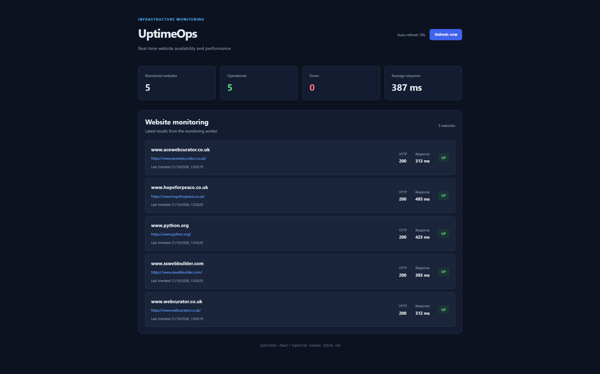
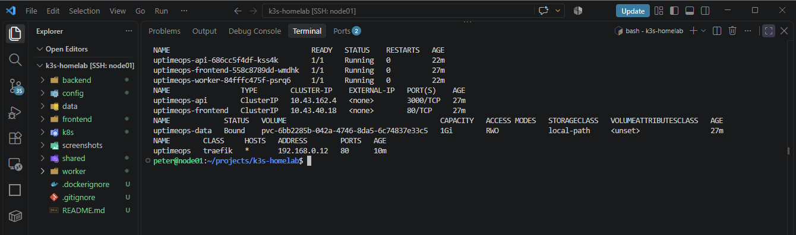
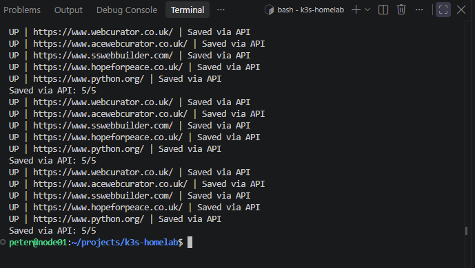

# UptimeOps — Kubernetes Website Monitoring Homelab

A full-stack website monitoring application built with **React, TypeScript, Node.js and SQLite**, containerised using Docker and deployed to a single-node **Kubernetes (k3s) homelab** running Ubuntu Server 24.04 LTS.

UptimeOps automatically checks website availability every 90 seconds, records HTTP status codes and response times, stores historical results, and presents monitoring data through a modern web dashboard.

The project demonstrates practical experience in **full-stack development, containerisation, Kubernetes orchestration, networking, persistent storage, security hardening and CI/CD automation**.

## Dashboard



## Project Overview

UptimeOps was developed as part of a hands-on DevOps engineering portfolio, progressing through several stages:

| Stage | Implementation |
|---|---|
| Application Development | Full-stack website monitoring platform |
| Docker Containerisation | Independent API, worker and frontend images |
| Day 15 — Kubernetes Homelab | k3s Deployments, Services and persistent storage |
| Day 16 — Kubernetes Networking | CoreDNS, ConfigMaps, Secrets and Traefik Ingress |
| Day 17 — Kubernetes CI/CD | GitHub Actions, Trivy, GHCR and automated deployment |

The application runs on a self-hosted Ubuntu Linux server using a single-node Kubernetes cluster.

## Architecture

The application uses three independently deployed Kubernetes workloads:

**Frontend → Backend → SQLite Database**

**Monitoring Worker → Backend → SQLite Database**

Incoming requests are routed through Traefik Ingress to the React frontend, served by Nginx. Nginx proxies API requests to the Express backend through an internal Kubernetes Service.

The monitoring worker periodically checks external websites and submits results to the backend through an authenticated REST API.

SQLite stores monitoring results on a persistent Kubernetes volume.

### Architecture Components

| Component | Responsibility |
|---|---|
| Traefik Ingress | Routes local-network HTTP traffic to the frontend |
| React + Nginx | Displays website availability and response times |
| Express API | Provides monitoring status, history and authenticated submissions |
| Monitoring Worker | Checks five websites every 90 seconds |
| SQLite | Stores monitoring history |
| Kubernetes PVC | Preserves database files across Pod restarts |
| Kubernetes Secret | Supplies the worker authentication token |
| GitHub Actions | Validates, builds, scans and publishes container images |
| GitHub Container Registry | Stores versioned application images |
| systemd Timer | Checks for successful CI runs and initiates deployments |
| k3s | Runs and manages the containerised workloads |

## Technology Stack

| Category | Technologies |
|---|---|
| Frontend | React, TypeScript, Vite |
| Backend | Node.js 24, Express |
| Database | SQLite |
| Web Server | Nginx |
| Monitoring | Node.js Fetch API |
| Containerisation | Docker, multi-stage builds |
| Orchestration | Kubernetes (k3s) |
| Networking | Traefik Ingress, CoreDNS, ClusterIP Services |
| Storage | Kubernetes PVC, local-path |
| Security | Kubernetes Secrets, API token authentication, non-root containers |
| CI/CD | GitHub Actions |
| Container Registry | GitHub Container Registry (GHCR) |
| Security Scanning | Trivy |
| Deployment Automation | Bash, GitHub CLI, systemd |
| Infrastructure | Ubuntu Server 24.04 LTS |

## Features

- Automated website monitoring every 90 seconds
- HTTP availability and response-time measurements
- UP, DOWN and RESTRICTED status classification
- React monitoring dashboard
- REST API for monitoring results and historical checks
- Persistent SQLite database
- Authenticated worker-to-backend communication
- Three independent Docker containers
- Kubernetes Deployments and Services
- Persistent storage through a 1 GiB PVC
- Kubernetes backend readiness probe
- Local-network access through Traefik Ingress
- Automated application validation
- Docker image builds and vulnerability scanning
- Container image publishing to GHCR
- Commit-SHA image versioning
- Pull-based Kubernetes deployment automation
- Kubernetes rollout verification

## Day 15 — Kubernetes Homelab



The application is deployed in the `uptimeops` namespace.

| Kubernetes Resource | Configuration |
|---|---|
| Deployments | 3 — frontend, backend, worker |
| Services | 2 — frontend and backend |
| PersistentVolumeClaim | 1 GiB, ReadWriteOnce |
| Secret | Worker API authentication |
| Ingress | Traefik, HTTP port 80 |
| Worker replicas | 1 |
| Backend replicas | 1 |
| Frontend replicas | 1 |

All three application Pods were verified running with zero restarts during initial deployment testing.

The API uses a `Recreate` deployment strategy to avoid overlapping database-writing Pods during updates.

## Day 16 — Kubernetes Networking

Extended UptimeOps with Kubernetes service discovery, ConfigMaps, Secrets and hostname-based Traefik Ingress.

Key improvements:

- Verified internal ClusterIP Services and EndpointSlices
- Tested CoreDNS resolution and backend HTTP connectivity
- Externalised worker configuration using a Kubernetes ConfigMap
- Changed the monitoring interval from 60 to 90 seconds without rebuilding Docker images
- Verified Secret-based authentication between worker and backend
- Configured local hostname access through `uptimeops.home.arpa`
- Validated Kubernetes manifests against the running cluster


**[Read the Kubernetes Networking documentation](docs/kubernetes-networking.md)**

### Networking Flow

1. A client accesses `http://uptimeops.home.arpa`.
2. Traefik routes the request to the frontend Service.
3. Nginx serves the React dashboard and proxies API requests.
4. Kubernetes Service discovery resolves the backend Service.
5. The API reads monitoring data from SQLite.
6. The worker communicates with the API through an internal ClusterIP Service.

The hostname is intended for the trusted home network and requires local hostname resolution.

## Day 17 — Kubernetes CI/CD

Day 17 introduces a CI/CD pipeline using **GitHub Actions, Docker, Trivy and GitHub Container Registry**.

The pipeline automates application validation, container builds, vulnerability scanning and image publishing.

A separate pull-based deployment mechanism on the homelab server checks for successful workflow runs and updates Kubernetes workloads.

### CI/CD Pipeline

```text
Developer
    |
    v
Git Push to main
    |
    v
GitHub Actions
    |
    +-- Validate application
    |
    +-- Build API image
    +-- Build Worker image
    +-- Build Frontend image
    |
    +-- Trivy vulnerability scanning
    |
    v
GitHub Container Registry
    |
    | Versioned images using commit SHA
    |
    v
node01 — systemd timer
    |
    +-- Check latest main workflow
    +-- Confirm successful completion
    +-- Identify commit SHA
    |
    v
Kubernetes (k3s)
    |
    +-- Deploy API
    +-- Deploy Worker
    +-- Deploy Frontend
    |
    v
Rollout verification
```

### 1. Application Validation

GitHub Actions validates the application before publishing images.

Validation includes:

- Backend JavaScript syntax checks
- Worker JavaScript syntax checks
- Frontend linting
- Frontend production build

A failed validation prevents the dependent publishing stage from completing successfully.

### 2. Docker Image Builds

Three independent Docker images are built:

| Component | Dockerfile |
|---|---|
| API | `backend/Dockerfile` |
| Worker | `worker/Dockerfile` |
| Frontend | `frontend/Dockerfile` |

The frontend uses a multi-stage build, with Node.js compiling the React application and Nginx serving the production files.

The API and worker use Node.js 24 Alpine-based images.

### 3. Container Security Hardening

Security improvements include:

- Running the backend and worker as a non-root user
- Removing unnecessary globally installed npm tooling from runtime images
- Applying available Alpine package upgrades in the frontend image
- Scanning Docker images with Trivy
- Keeping authentication credentials in Kubernetes Secrets
- Separating application components into independent containers

Trivy scans were introduced to identify known vulnerabilities in container images.

**Current limitation:** Trivy findings are reported but do not fail the pipeline. A successful workflow does not guarantee that all vulnerabilities have been resolved.

### 4. GitHub Container Registry

Successful pushes to `main` publish three images to GHCR.

| Component | Container Image |
|---|---|
| API | `ghcr.io/ptr-prkr/uptimeops-api` |
| Worker | `ghcr.io/ptr-prkr/uptimeops-worker` |
| Frontend | `ghcr.io/ptr-prkr/uptimeops-frontend` |

Images use the Git commit SHA as their version tag.

Example:

`ghcr.io/ptr-prkr/uptimeops-api:c0fb7fc...`

The full commit SHA is used in actual image references.

This provides traceability between source code, CI execution and deployed containers.

All three GHCR packages were confirmed published successfully in GitHub Actions run [39631227216](https://github.com/ptr-prkr/k3s-homelab/actions/runs/39631227216).

The packages are public, allowing Kubernetes to pull images without additional registry credentials.

### 5. Automated GHCR to k3s Deployment

The deployment design uses a **pull-based approach** rather than a publicly accessible Kubernetes API or a self-hosted GitHub Actions runner.

The deployment script is:

`scripts/deploy-ghcr.sh`

The systemd units are:

- `systemd/uptimeops-deploy.service`
- `systemd/uptimeops-deploy.timer`

The timer checks for updates approximately every five minutes.

The deployment process:

1. Queries the latest `main` push workflow using GitHub CLI.
2. Confirms that the workflow has completed successfully.
3. Retrieves the associated Git commit SHA.
4. Checks that all three application Deployments have one desired replica.
5. Updates the API, worker and frontend images to the matching GHCR commit-SHA tags.
6. Waits for Kubernetes rollout verification.
7. Reports deployment results through systemd logs.

The script uses a lock to prevent overlapping deployment checks.

It also respects intentional shutdowns: if an application Deployment is scaled away from one replica, the deployment is skipped.

**Deployment verification:** The publishing workflow has been verified. The unattended deployment mechanism must be tested against the running cluster before it is considered operational.

### 6. Deployment Commands

Run a manual deployment check:

```bash
./scripts/deploy-ghcr.sh
```

Check the timer:

```bash
systemctl status uptimeops-deploy.timer
systemctl list-timers uptimeops-deploy.timer
```

Inspect deployment logs:

```bash
sudo journalctl -u uptimeops-deploy.service -n 50 --no-pager
```

Inspect deployed images:

```bash
kubectl -n uptimeops get deployments \
  -o custom-columns=NAME:.metadata.name,IMAGE:.spec.template.spec.containers[0].image
```

Check Kubernetes rollout status:

```bash
kubectl -n uptimeops rollout status deployment/uptimeops-api
kubectl -n uptimeops rollout status deployment/uptimeops-worker
kubectl -n uptimeops rollout status deployment/uptimeops-frontend
```

### 7. Rollback and Recovery

Kubernetes maintains Deployment revision history, allowing previous configurations to be restored.

Example:

```bash
kubectl -n uptimeops rollout history deployment/uptimeops-api
kubectl -n uptimeops rollout undo deployment/uptimeops-api
```

For a manual rollback, first stop the deployment timer to prevent the automation from immediately reapplying the latest successful image:

```bash
sudo systemctl stop uptimeops-deploy.timer
```

After investigating and fixing the problem, the timer can be restarted:

```bash
sudo systemctl start uptimeops-deploy.timer
```

Automatic rollback and application-level smoke testing remain future improvements.

## Manual Deployment Instructions

The original deployment method uses locally built Docker images imported into k3s.

This remains useful for initial installation, troubleshooting and understanding Kubernetes container runtimes.

### 1. Build Docker Images

From the project root:

```bash
docker build -f backend/Dockerfile -t uptimeops-api:local .
docker build -f worker/Dockerfile -t uptimeops-worker:local .
docker build -f frontend/Dockerfile -t uptimeops-frontend:local .
```

### 2. Import Images into k3s

Export the images:

```bash
docker save \
  uptimeops-api:local \
  uptimeops-worker:local \
  uptimeops-frontend:local \
  -o /tmp/uptimeops-images.tar
```

Import them into the k3s containerd runtime:

```bash
sudo k3s ctr -n k8s.io images import /tmp/uptimeops-images.tar
```

### 3. Create Kubernetes Namespace

```bash
kubectl create namespace uptimeops
```

### 4. Create Worker Authentication Secret

Generate a secure token and create the Secret:

```bash
kubectl -n uptimeops create secret generic uptimeops-worker-token \
  --from-literal="token=$(openssl rand -hex 32)"
```

The same Secret is supplied to the backend and worker through environment variables.

Do not regenerate this Secret unnecessarily on an existing deployment.

### 5. Deploy the Application

```bash
kubectl apply -f k8s/worker-configmap.yaml
kubectl apply -f k8s/uptimeops.yaml
kubectl apply -f k8s/ingress.yaml
```

The original Kubernetes manifest uses local images with `imagePullPolicy: Never`.

For GHCR-based deployment, the automated script updates the image references and pull policy.

Reapplying the original manifest may restore the local image references. Rerun the deployment script when appropriate.

### 6. Verify Kubernetes Resources

```bash
kubectl -n uptimeops get pods,svc,pvc,ingress
```

Check worker logs:

```bash
kubectl -n uptimeops logs deployment/uptimeops-worker --tail=20
```

The dashboard is accessible through the local hostname:

`http://uptimeops.home.arpa`

## Monitoring Worker



The worker performs availability checks every 90 seconds.

Each monitoring result includes:

- Website URL
- Availability status
- HTTP status code
- Response time in milliseconds
- Timestamp

The worker sends results to the Express API using the `X-Worker-Token` authentication header.

Successful monitoring cycles were verified with **5/5 results saved via API**.

## REST API

| Method | Endpoint | Description |
|---|---|---|
| GET | `/health` | Backend health check |
| GET | `/api/status` | Latest monitoring results |
| GET | `/api/history?url=...` | Historical website checks |
| POST | `/api/checks` | Authenticated monitoring submissions |

## Database and Persistent Storage

UptimeOps uses SQLite for monitoring history.

The backend mounts a Kubernetes PersistentVolumeClaim at `/data`, with the database stored at:

`/data/uptimeops.db`

SQLite uses Write-Ahead Logging (WAL) to support database operations.

The persistent volume preserves monitoring history across container and Pod restarts.

The API runtime has been hardened to use a non-root user. Database ownership and permissions must remain compatible with the container's runtime UID.

Because this is a single-node homelab using local storage, it does not provide high availability or off-node disaster recovery.

### Backup Considerations

SQLite database backups should preserve consistency, including WAL state.

Database files must not be committed to GitHub.

Automated SQLite backups, retention policies and off-node recovery remain future improvements.

## Project Structure

| Directory | Contents |
|---|---|
| `.github/workflows/` | GitHub Actions CI/CD workflow |
| `backend/` | Express API and backend Dockerfile |
| `worker/` | Monitoring worker and Dockerfile |
| `frontend/` | React application, Nginx configuration and Dockerfile |
| `shared/` | SQLite database operations |
| `config/` | Website monitoring configuration |
| `k8s/` | Kubernetes Deployments, Services, PVC and Ingress |
| `scripts/` | GHCR-to-k3s deployment automation |
| `systemd/` | Deployment service and timer definitions |
| `docs/` | Supporting technical documentation |
| `screenshots/` | Dashboard and deployment evidence |

## Security

The application includes several security measures:

- Token authentication for monitoring submissions
- Kubernetes Secret for credential distribution
- Internal ClusterIP Services for application communication
- SQLite database isolated from direct network access
- Git exclusions for database files, credentials and environment variables
- Non-root execution for the backend and worker
- Reduced runtime container tooling
- Container vulnerability scanning using Trivy
- GitHub Actions permissions scoped to workflow requirements
- Commit-SHA image tagging for release traceability
- No public exposure of the Kubernetes API for deployment automation

**Security limitation:** The dashboard currently uses unauthenticated HTTP and is intended for a trusted home network.

Public deployment would require HTTPS, access controls and additional security hardening.

## Troubleshooting and Lessons Learned

This project provided practical experience in:

- Building and integrating a full-stack application
- Separating the frontend, backend and monitoring worker
- Containerising applications with Docker
- Importing locally built images into Kubernetes containerd
- Configuring Kubernetes Deployments, Services and Secrets
- Provisioning persistent storage with local-path
- Configuring Traefik Ingress and Kubernetes DNS
- Troubleshooting HTTP 401 authentication failures
- Debugging application networking and worker communication
- Inspecting Kubernetes Pods, logs and resource health
- Managing container image vulnerabilities
- Hardening Docker images for non-root execution
- Understanding GitHub CLI token scopes and GHCR permissions
- Building GitHub Actions workflows
- Publishing container images to GHCR
- Designing pull-based Kubernetes deployment automation
- Using immutable commit-SHA image references
- Preserving persistent application data during updates

A notable challenge involved HTTP 401 errors between the Kubernetes worker and backend. Regenerating the Kubernetes authentication Secret and restarting both deployments resolved the issue.

Another challenge involved running the API as a non-root user while maintaining access to SQLite database files stored on a persistent volume. This required careful handling of file ownership and permissions.

The project also demonstrated the distinction between GitHub authentication and authorisation: accessing GHCR packages through GitHub CLI required the `read:packages` token scope.

## Future Improvements

- HTTPS and dashboard authentication
- Email or webhook downtime alerts
- Historical response-time charts
- Prometheus and Grafana integration
- Automated deployment rollback and notifications
- Application-level post-deployment smoke tests
- Enforced vulnerability scan thresholds
- Automated SQLite backups and off-node retention
- Multi-node Kubernetes deployment
- High availability and disaster recovery

## Author

**Peter Parker**

Cloud Infrastructure | DevOps | Software Engineering

Built as part of a hands-on DevOps engineering portfolio.