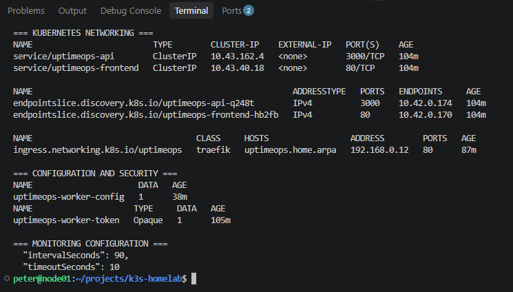

# Day 16 — Kubernetes Networking

## Overview

Day 16 extends the UptimeOps Kubernetes homelab by introducing and validating Kubernetes networking, internal service discovery, external routing and configuration management.

The existing application remains deployed on a single-node k3s cluster running Ubuntu Server 24.04 LTS.

## Networking Architecture

The application uses the following communication paths:

**Browser → Traefik Ingress → Frontend Service → Nginx/React**

**Frontend Nginx → Backend Service → Express API → SQLite**

**Monitoring Worker → Backend Service → Express API → SQLite**

Kubernetes Services provide stable networking endpoints, while CoreDNS resolves internal Service names.

## Services and EndpointSlices

UptimeOps uses two ClusterIP Services:

| Service | Port | Purpose |
|---|---|---|
| `uptimeops-api` | 3000 | Internal backend communication |
| `uptimeops-frontend` | 80 | Frontend access through Traefik |

EndpointSlices identify the Pod endpoints backing each Service.

This allows Kubernetes to route traffic to replacement Pods without applications relying on fixed Pod IP addresses.

## Kubernetes DNS

The backend Service is accessible through:

- `uptimeops-api`
- `uptimeops-api.uptimeops.svc.cluster.local`

Both names successfully resolved to the backend ClusterIP.

An HTTP request to `http://uptimeops-api:3000/health` returned `200 OK`, confirming internal Service connectivity.

## ConfigMaps

The monitoring worker now receives its website configuration through the `uptimeops-worker-config` ConfigMap.

The ConfigMap is mounted read-only at:

`/app/config/websites.json`

The monitoring interval was changed from 60 to 90 seconds without rebuilding the Docker image.

Because the configuration is mounted using `subPath` and loaded when the worker starts, a Pod restart is required to apply changes.

## Kubernetes Secrets

The backend and monitoring worker use the same Kubernetes Secret:

`uptimeops-worker-token`

The Secret supplies the `WORKER_API_TOKEN` environment variable.

The worker authenticates monitoring submissions using the `X-Worker-Token` HTTP header.

The Secret's value is not committed to Git.

## Traefik Ingress

The application supports hostname-based routing using:

`http://uptimeops.home.arpa/`

The hostname is mapped to the homelab server's private IP address through the Windows hosts file.

Traefik routes incoming requests to the frontend Kubernetes Service.

A catch-all Ingress rule also preserves access through the server's IP address.

The local hostname does not automatically provide public DNS resolution or HTTPS.

## Verification

The following tests were completed successfully:

| Test | Result |
|---|---|
| Kubernetes EndpointSlices | Correct Pod endpoints |
| Short Service DNS name | Resolved successfully |
| Fully qualified Service DNS name | Resolved successfully |
| Backend HTTP health check | 200 OK |
| ConfigMap-mounted worker | Operational |
| Worker API submissions | 5/5 successful |
| Kubernetes Secret references | Verified |
| Hostname-based Ingress | 200 OK |
| Windows hostname resolution | 192.168.0.12 |
| Kubernetes manifest validation | Passed |
| Configuration drift check | No differences |

## Evidence

## Key Learning Outcomes

- Understanding Pod IP addresses versus stable ClusterIP Services
- Using EndpointSlices to identify Service backends
- Testing Kubernetes CoreDNS and internal Service discovery
- Separating application configuration from container images
- Using ConfigMaps for non-sensitive settings
- Using Kubernetes Secrets for credentials
- Configuring hostname-based routing through Traefik Ingress
- Understanding differences between Windows hosts-file resolution and Kubernetes DNS
- Maintaining consistency between Git-managed manifests and live infrastructure

## Future Improvements

- HTTPS for the local dashboard
- Centralised DNS for the home network
- Kubernetes NetworkPolicies
- Automated configuration rollout
- CI/CD validation for Kubernetes manifests
- Monitoring and alerting integration
